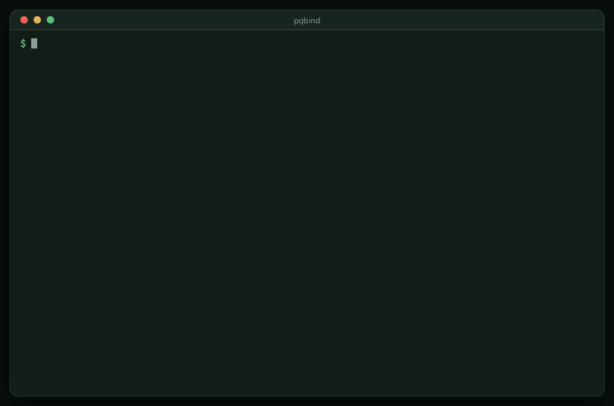
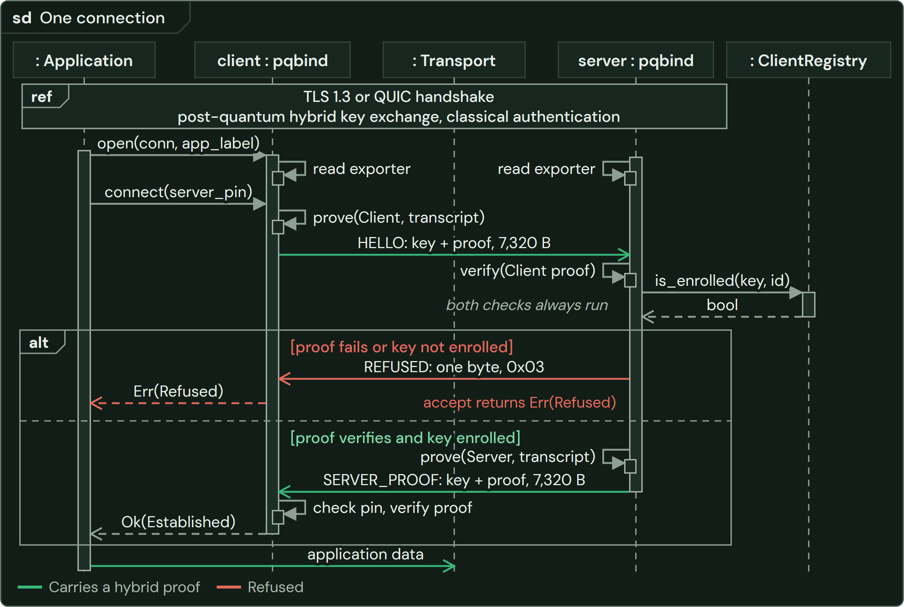
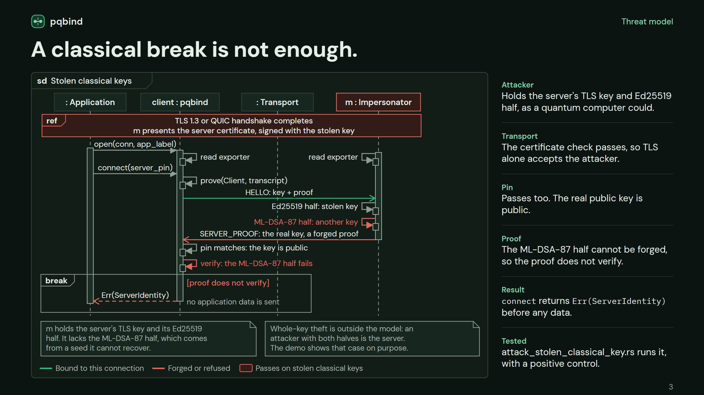
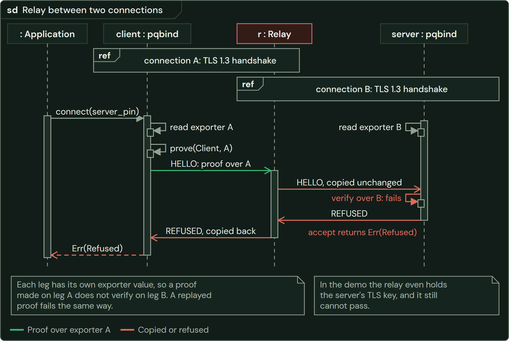
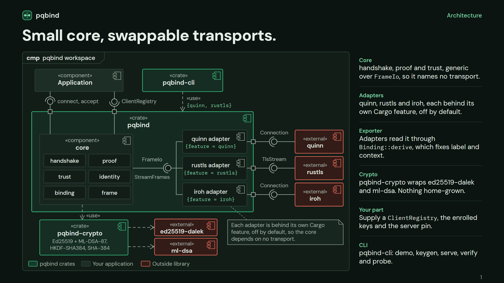

<div align="center">

# pqbind

**Post-quantum authentication for connections that already have post-quantum key exchange.**

Break the classical key and you still can't get in.

[](https://crates.io/crates/pqbind)
[](https://docs.rs/pqbind)
[](https://crates.io/crates/pqbind)
[](LICENSING.md)
[](#security-model)



</div>

## The gap

TLS and QUIC are adopting ML-KEM hybrids for key exchange, which stops recorded traffic from being decrypted later. Authentication
has not moved. Certificates and node identities are still classical, and post-quantum certificates are not deployed. So a
connection can use a post-quantum key exchange and still be impersonated by anyone who can forge a classical signature.

pqbind closes that gap now, without waiting for post-quantum certificates. The longer argument is in
[Your TLS is post-quantum. Your authentication isn't.](docs/background.md)

## How it works

After the normal TLS 1.3 or QUIC handshake, each peer signs the connection's own TLS exporter value, together with both transport
identities and both key pins, using a hybrid Ed25519 and ML-DSA-87 key. A signature verifies only when both halves verify.

<p align="center">
  
</p>

- An attacker who forges the classical identity cannot produce the ML-DSA half.
- A relay between two connections sees a different exporter value on each leg, so a proof made on one leg fails on the other.
- Keys are enrolled or pinned beforehand. A key that arrives in the connection is never trusted because it arrived.
- No post-quantum certificates are involved, so it works with the certificates and node identities you already have.

## Try it

```bash
git clone https://github.com/AlpharomeroJL/pqbind
cd pqbind
cargo run -p pqbind-cli -- demo
```

`demo` runs eight scenarios over a real QUIC connection on 127.0.0.1 and exits 0 only if every one behaves as expected, so it also
works as a self-test. Add `--transport tls` for TLS over TCP.

| | Scenario | Outcome |
|---|---|---|
| a | Honest client and server | both authenticate |
| b1 | Attacker holds the server's TLS key and Ed25519 key and forges the proof | client refuses (`ServerIdentity`) |
| b2 | Same attacker runs the real pqbind code with its own key | client refused |
| c | Attacker holds an enrolled client's Ed25519 key | server refuses |
| d | Relay between two connections | server refuses the relayed proof |
| e | A client that was never enrolled | refused |
| f1, f2 | The whole private key is stolen | attacker is accepted; this is outside the model |

<p align="center">
  
</p>

<p align="center">
  
</p>

## Use it in your project

Add the library from [crates.io](https://crates.io/crates/pqbind) and enable the adapter for your transport:

```bash
cargo add pqbind --features quinn   # or rustls, iroh
```

To get the command line tool:

```bash
cargo install pqbind-cli
```

The handshake is generic over a frame channel, so you can try it without any transport. This runs as a doctest in
[`crates/pqbind/src/lib.rs`](crates/pqbind/src/lib.rs):

```rust
use pqbind::{Binding, Enrollment, HybridIdentity, MemoryRegistry, PeerId, StreamFrames, accept, connect};

let client = HybridIdentity::generate()?;
let server = HybridIdentity::generate()?;

// Enrollment happens before any connection, outside pqbind: the server enrolls the client's
// public key, and the client keeps the pin (SHA-384 of the whole public key) of the server.
let registry = MemoryRegistry::new();
registry.enroll(Enrollment { key: client.public(), peer_id: PeerId::anonymous(), enrolled_at_unix_millis: 0 });
let server_pin = server.pin();

// An adapter gives each end a `StreamFrames` over the live connection. Here, an in-memory pipe.
let (client_pipe, server_pipe) = tokio::io::duplex(64 * 1024);
let exporter = [7_u8; 64];
let (client_read, client_write) = tokio::io::split(client_pipe);
let (server_read, server_write) = tokio::io::split(server_pipe);
let mut client_io = StreamFrames::new(client_read, client_write, Binding::new(b"my-app/v1", exporter)?);
let mut server_io = StreamFrames::new(server_read, server_write, Binding::new(b"my-app/v1", exporter)?);

let server_id = PeerId::new(b"the server's transport identity".to_vec())?;
let anonymous = PeerId::anonymous();
let (from_client, from_server) = tokio::join!(
    connect(&mut client_io, &client, &anonymous, &server_id, &server_pin),
    accept(&mut server_io, &server, &server_id, &anonymous, &registry),
);
assert_eq!(from_client?.peer_key(), &server.public()); // the client knows it talks to the pinned server
assert_eq!(from_server?.peer_key(), &client.public()); // the server knows it talks to an enrolled client
```

Neither end may send application data until its call returns `Ok`, and your application must refuse a connection that does not
complete the handshake. For a full connection over real QUIC, run the example:

```bash
cargo run -p pqbind --example quinn_client_server --features quinn
```

## Command line

| Command | What it does |
|---|---|
| `pqbind demo` | Runs the eight attack scenarios above over QUIC or TLS |
| `pqbind keygen` | Makes a hybrid identity (seed file and public key file) and prints its pin |
| `pqbind enroll` | Keeps the file of enrolled clients: `add` a key after checking its pin, `list` the clients, `revoke` one |
| `pqbind serve` | Runs a small pqbind server on loopback, with a list of enrolled clients |
| `pqbind verify` | Connects to a pqbind server with a pinned key; exit 0 verified, 1 refused, 2 error |
| `pqbind probe` | Reports which post-quantum key exchange groups a host accepts |

```bash
pqbind keygen --out client.seed --public-out client.pub
pqbind serve  --listen 127.0.0.1:4433 --identity server.seed --enroll client.pub --cert-out server.pem
pqbind verify 127.0.0.1:4433 --pin <the pin serve printed> --identity client.seed --ca server.pem
```

### First contact: how a key becomes trusted

pqbind never trusts a key because it arrived in a connection. Before the first connection, each side learns the other's key some
other way, and you have to make sure it is the right one. The pin is the short check: the SHA-384 hash of a whole public key,
which `keygen` prints.

1. The client's owner runs `pqbind keygen` and sends you the public key file. They also tell you the pin, through a channel you
   trust (in person, a phone call, a signed message), not the channel that carried the file.
2. You enroll the key. The command refuses unless the pin you give matches the key:

   ```bash
   pqbind enroll add --registry clients.reg --key client.pub --pin <the pin the owner told you>
   ```

   Without `--pin` it prints the pin and asks you to type `yes`. When input is not a terminal it refuses, so a script can never
   enroll a key unchecked.
3. Start the server with the file: `pqbind serve --registry clients.reg ...`. The server reads it when it starts.
4. To remove a client, run `pqbind enroll revoke --registry clients.reg --pin <pin or its first 16 digits>` and restart the server.
   `pqbind enroll list --registry clients.reg` shows who is enrolled.

The server's own pin goes the other way: the client keeps it and passes it to `verify --pin`. Delivering that pin is up to you in
the same way. If a registry file is damaged or from another version, `serve` stops with an error instead of starting with nobody
enrolled.

`probe` tries one key exchange group at a time (X25519MLKEM768, SecP256r1MLKEM768, SecP384r1MLKEM1024, pure MLKEM1024 and two
classical baselines) and gives a verdict per host. It does not validate certificates. A run on 2026-11-15:

```text
cloudflare.com   PQ capable (X25519MLKEM768)
google.com       PQ capable (X25519MLKEM768, MLKEM1024)
```

## Architecture

<p align="center">
  
</p>

| Crate | Role |
|---|---|
| [`pqbind-crypto`](crates/pqbind-crypto) | The hybrid Ed25519 + ML-DSA-87 signature, HKDF-SHA384 and SHA-384. About 1,500 lines, small enough to review on its own. |
| [`pqbind`](crates/pqbind) | Identity and pins, exporter binding, the proof, the enrolled-client registry, framing and the handshake. Adapters for quinn, rustls (TLS 1.3 over TCP) and iroh, each behind a Cargo feature. |
| [`pqbind-cli`](crates/pqbind-cli) | The `pqbind` command |

The [architecture page](docs/ARCHITECTURE.md) has all eight UML diagrams: components, the handshake sequence, the two attack
sequences, core classes, handshake states, the byte formats and the trust deployment. [DESIGN.md](DESIGN.md) describes the formats
and the reasoning.

## Security model

| pqbind stops | pqbind does not cover |
|---|---|
| An attacker who forged a peer's classical identity | Theft of a whole private key (both halves) |
| A relay or man in the middle between two connections | How a key is enrolled in the first place |
| Replay of an old proof | Confidentiality, which is the transport's key exchange |
| Reflection of a server proof as a client proof | Peers that do not run pqbind, such as browsers |
| A client that was never enrolled, or that pinned another key | Whether the transport really negotiated a post-quantum key exchange |

The full list is in [THREAT_MODEL.md](THREAT_MODEL.md).

**Status.** pqbind is pre-1.0. The design has not had an independent review. The ML-DSA half depends on the RustCrypto `ml-dsa`
crate (0.1), which states that it has not been independently audited, and the hybrid composition of Ed25519 and ML-DSA-87 is a
custom construction, not an IETF composite scheme. pqbind is not FIPS validated. The [review guide](docs/REVIEW.md) lists what a
reviewer should look at and the questions that matter most. To report a vulnerability, see [SECURITY.md](SECURITY.md).

## Tests and platforms

```bash
cargo test --workspace --all-features
```

The suite covers NIST ACVP known answers for ML-DSA-87, attack tests that give the attacker one half of a key, replay, relay and
malformed-frame cases, random and near-valid hostile input, known-answer vectors that pin the wire formats, five fuzz targets, and
real QUIC, TLS and iroh connections on loopback.

- All 209 tests pass on Windows 11 and on Ubuntu under WSL 2. Both Apple targets compile; the code has not run on macOS.
- The minimum Rust version is 1.94 (tests run on 1.94.1). `cargo clippy`, `cargo doc`, `cargo deny` and REUSE checks run clean.
- ML-DSA-87 key expansion needs about 1 MiB of stack in a debug build (0.5 MiB in release). Do not call it on a smaller stack.

## License

pqbind is available under the **GNU Affero General Public License, version 3** (`AGPL-3.0-only`), or under a **commercial license**
from VaultScribe Limited Liability Company for use in closed products. See [LICENSING.md](LICENSING.md).

VaultScribe™ is a trademark of VaultScribe Limited Liability Company. See [TRADEMARKS.md](TRADEMARKS.md).
