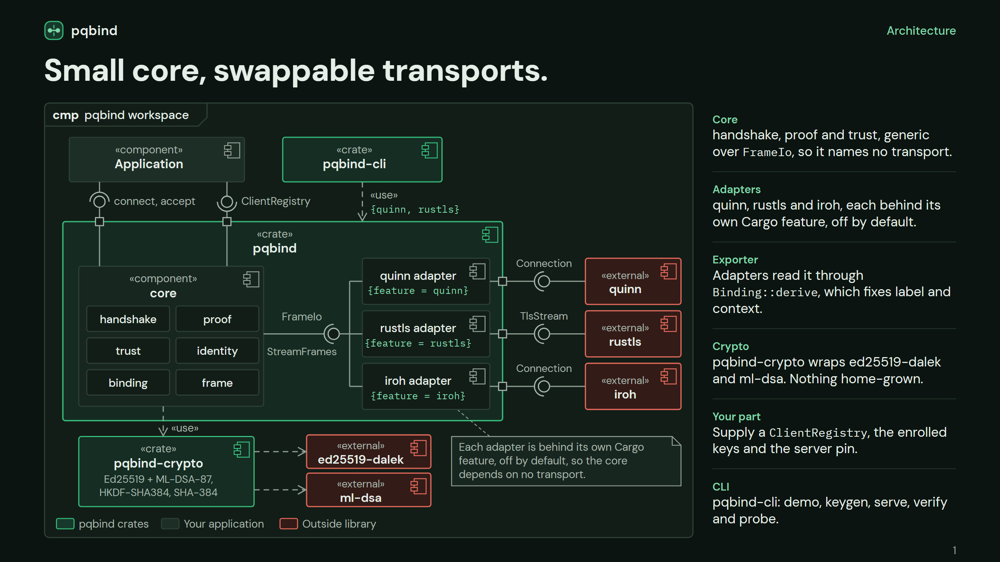
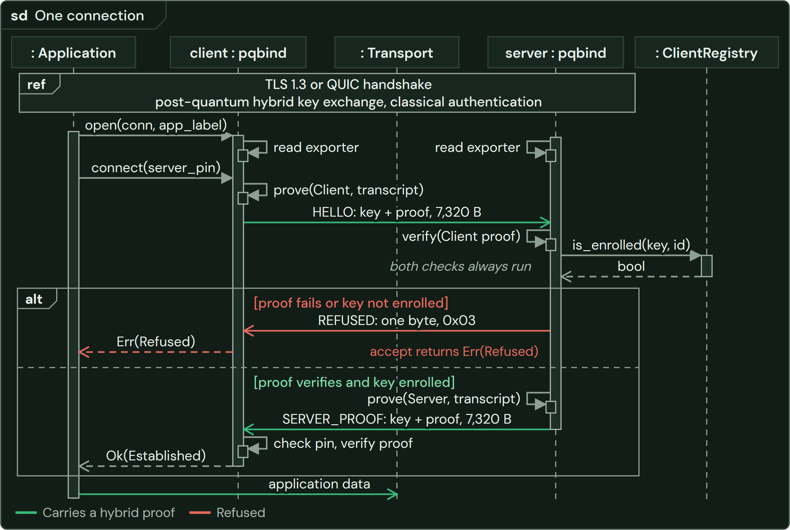
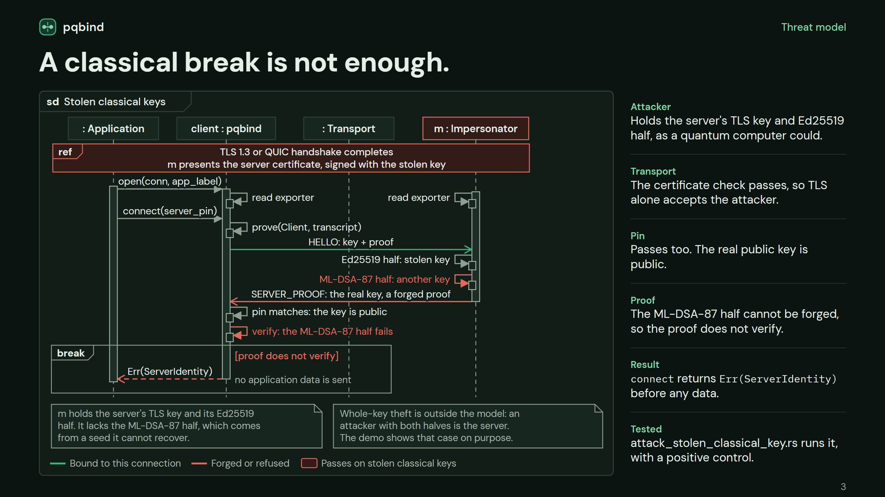
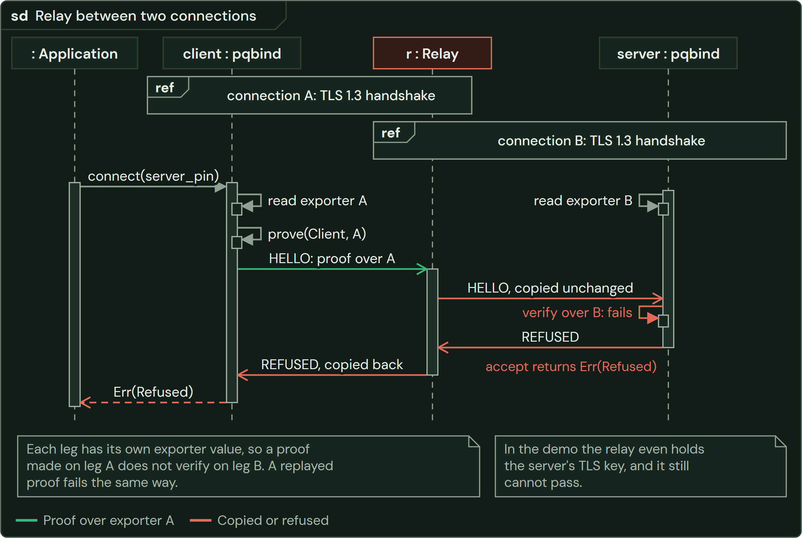
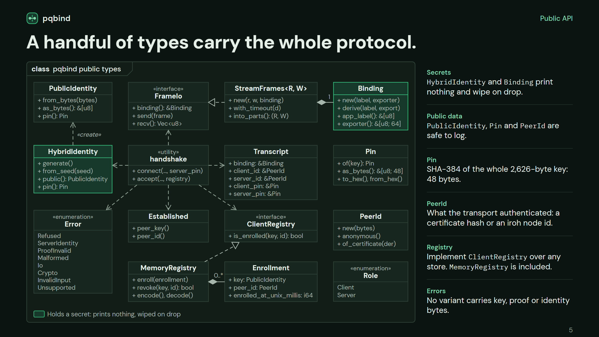
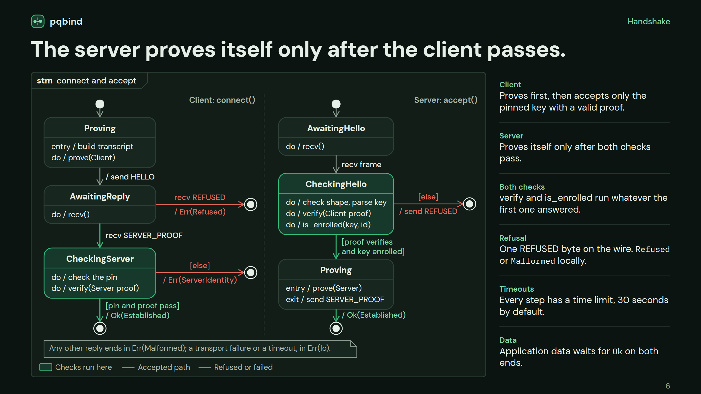
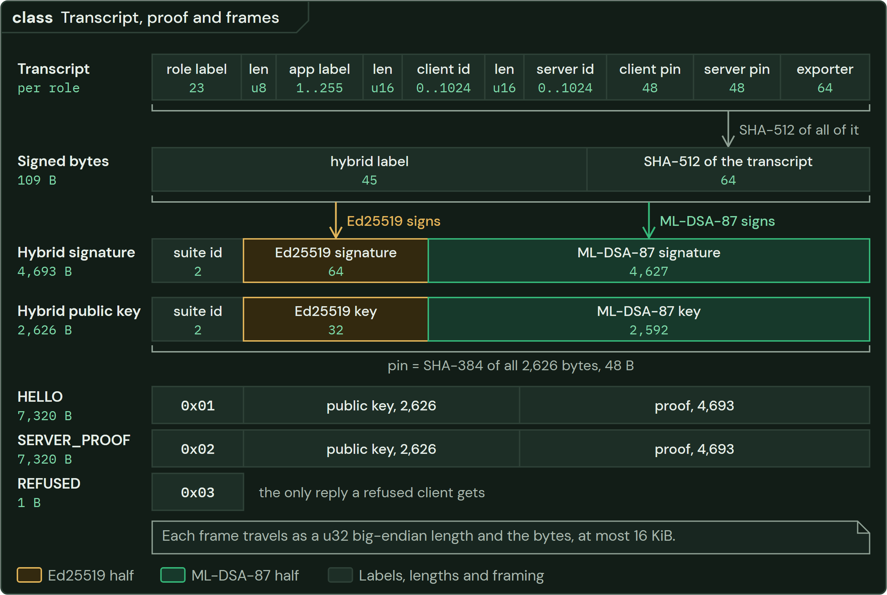
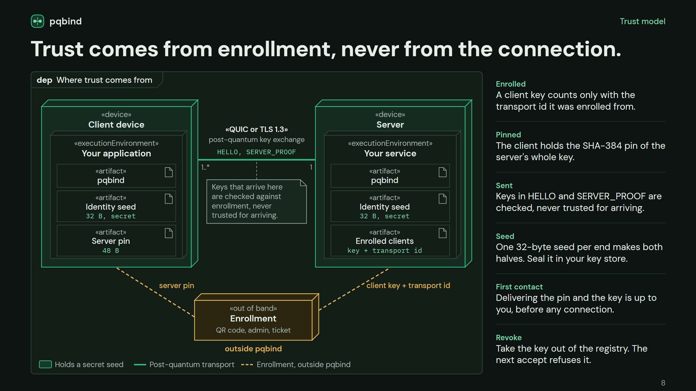

# Architecture

This page shows how the pieces of pqbind fit together: the crates, one connection from start to finish, two attacks and how the
design answers them, the main types, the states of each end, the bytes on the wire, and how trust is set up. It ends with a map of
the source files. The reasons behind the choices are in [DESIGN.md](../DESIGN.md), and what is and is not defended against is in
[THREAT_MODEL.md](../THREAT_MODEL.md).

## Components



*The crates, their interfaces and the transport underneath.*

pqbind sits between your application and a transport you already have. The application calls `pqbind::connect` (client) or
`pqbind::accept` (server) on a finished TLS 1.3 or QUIC connection.

- **`pqbind-crypto`** holds the hybrid signature and everything under it. It invents no algorithm: Ed25519, ML-DSA-87, HKDF-SHA384,
  SHA-384 and SHA-512 come from established crates, wrapped with zeroization and with errors that carry no secret bytes. A test
  fails if a known primitive constant or an unlisted dependency appears in it.
- **`pqbind`** is the protocol: the handshake, the proof transcript, identities and pins, the enrollment registry, the exporter
  binding and the frame reader. The core depends on no transport. It is generic over `FrameIo`, a channel that carries whole frames
  and knows the connection's exporter value.
- **The adapters** (`quinn`, `rustls` and `iroh`, each behind its own Cargo feature) connect the core to a transport. Each does two
  jobs: read the exporter value, always through `Binding::derive` so the label and context cannot be passed wrongly, and carry
  frames over one stream. Each also names the remote end's transport identity.
- **`pqbind-cli`** is the `pqbind` command (`demo`, `keygen`, `serve`, `verify`, `probe`). It is built on the library, and nothing
  depends on it.

## One connection



*The messages of one connection, from the transport handshake to application data.*

1. The transport handshake runs as usual. The key exchange is post-quantum if the application configured it that way, and the server
   certificate is checked classically.
2. Each adapter reads the 64-byte exporter value (label `EXPORTER-pqbind-v1`, context the application label) and names the remote
   end: the SHA-384 of the leaf certificate for TLS and QUIC, the 32-byte node ID for iroh, and anonymous when there is no
   certificate. Both ends read the same exporter value.
3. The client sends HELLO: its public key and a hybrid proof over the client transcript (7,320 bytes).
4. The server checks the frame shape and parses the key, then verifies the proof and checks enrollment. Both checks always run.
5. If both pass, the server answers SERVER_PROOF with its public key and its proof. Otherwise it answers REFUSED, always the same
   single byte.
6. The client checks the key against its pin and verifies the proof. On any failure it returns an error and sends no application
   data.
7. Application data flows on the same streams, only after `connect` or `accept` returned `Ok` on that end.

What each step provides:

- Step 2 makes every proof specific to one connection: another connection reads another exporter value, so a proof can be neither
  replayed nor relayed.
- Step 4 means a server never reveals which check failed, and never proves itself to a client that has not passed.
- Step 6 means a client never sends application data to a peer that has not proved the pinned key.

## An attacker with the classical keys



*An attacker holds the server's TLS key and its Ed25519 key, and the client refuses it.*

This is the case pqbind exists for. The attacker can complete the classical part of the handshake, because it holds the TLS key,
and it can sign with the Ed25519 half of the server's hybrid key. It cannot produce the ML-DSA half. If it forges a proof, the
client's verification fails (demo scenario b1). If it runs the real pqbind code with a key of its own, the key does not have the
pin the client holds (b2). The same reasoning covers an attacker holding an enrolled client's Ed25519 key (c).

## A man in the middle



*A relay copies frames between two connections, and both ends refuse.*

A relay terminates one connection from the client and opens another to the server, and copies pqbind frames between them. Each leg
is a different TLS session, so each reads a different exporter value. A proof signed on one leg does not verify on the other, and
both ends are refused (demo scenario d).

The demo runs the other cases too: an honest pair (a), a valid key that was never enrolled, refused with the same single byte as
every other refusal (e), and theft of a whole private key on either side (f1, f2), where the attacker is accepted because that is
outside the model.

## Core types



*The main types and how they relate.*

| Type | Role |
|---|---|
| `HybridIdentity` | A hybrid signing key made from one seed, with its public key. |
| `PublicIdentity` | A hybrid public key in its canonical encoding (2,626 bytes). One key has one encoding and one pin. |
| `Pin` | The SHA-384 of a whole encoded public key (48 bytes). A client keeps the pin of the server it expects. |
| `PeerId` | A peer's transport identity (up to 1,024 bytes), or anonymous. |
| `Binding` | The exporter value of one connection and the application label it was read under. It wipes itself on drop. |
| `Transcript`, `Role` | What a proof binds, and which end it is for. |
| `ClientRegistry`, `MemoryRegistry` | The enrolled clients: each hybrid key with the transport identity it was enrolled from. The application can supply its own registry. |
| `FrameIo`, `StreamFrames` | A channel of whole frames that knows its connection's `Binding`, and its implementation over a pair of async streams. |
| `Error` | The failure type. Its variants carry no key, proof or identity bytes. |

## States of each end



*The client and server state machines.*

The handshake is a short state machine on each side (`handshake.rs`). The client sends HELLO, waits for one reply, and ends as
`Established` or as an error: `Refused`, `ServerIdentity` (wrong pin or bad proof), `Malformed` or `Io`. The server waits for one
frame, runs the checks, and either sends SERVER_PROOF and ends as `Established`, or sends REFUSED and ends with an error. Every
step has a time limit (30 seconds by default), so a silent peer ends a call with an I/O error rather than hanging it.

## Bytes on the wire



*The layouts of the transcript, the HELLO and SERVER_PROOF frames, the public key and the signature.*

A proof is a hybrid signature over this transcript, built by `proof.rs`:

```text
role label | u8 length, application label | u16 length, client id | u16 length, server id
           | client pin (48) | server pin (48) | exporter value (64)
```

The role label is `pqbind/proof/client/v1` or `pqbind/proof/server/v1`, each ending in a zero byte. The hybrid key signs
`label | SHA-512(transcript)` with both halves: Ed25519 (64 bytes) and ML-DSA-87 (4,627 bytes), behind a two-byte suite identifier,
4,693 bytes in all. A public key is the suite identifier, the 32-byte Ed25519 key and the 2,592-byte ML-DSA-87 key, 2,626 bytes.
HELLO and SERVER_PROOF are each a one-byte tag, a public key and a proof, 7,320 bytes. REFUSED is one byte. Each frame on the wire
is a four-byte big-endian length and the bytes, at most 16 KiB.

## Trust and deployment



*What each side holds before the connection, and where it comes from.*

pqbind trusts only what was set up beforehand, outside the connection:

- The **server** holds its own hybrid identity and a `ClientRegistry`: the enrolled clients' public keys, each with the transport
  identity it was enrolled from. The application supplies the registry, and `MemoryRegistry` is a ready one.
- The **client** holds its own hybrid identity and the **pin** of the server it expects, a 48-byte SHA-384 of the server's whole
  public key, small enough for a QR code.
- Keys that arrive in a HELLO or SERVER_PROOF are never trusted because they arrived. The server checks the enrolled list, and the
  client checks the pin.

How a key becomes enrolled or pinned is outside pqbind's guarantee. If the pin or the enrolled key came over a channel an attacker
controlled, the guarantee does not hold.

## Module map

Line counts come from `wc -l` and are approximate. Every source file starts with a `//! Responsibility:` line that says what it is
for.

### `crates/pqbind-crypto/src`

| File | Lines | What it does |
|---|---:|---|
| `lib.rs` | 42 | Crate docs, the module list and `#![deny(missing_docs)]`. |
| `suite.rs` | 76 | The one signature suite and its two-byte wire identifier. |
| `hybrid.rs` | 342 | The hybrid key, public key and signature: both halves sign `label \| SHA-512(message)`, both must verify. |
| `mldsa.rs` | 212 | ML-DSA-87 key, public key and signature, deterministic, empty context; refuses an all-zero `t1`. |
| `sign.rs` | 181 | Ed25519 key, public key and signature, with strict verification. |
| `kdf.rs` | 80 | HKDF-SHA384. |
| `hash.rs` | 142 | SHA-384, HMAC-SHA-384 and a streaming SHA-384 hasher. |
| `sha384.rs` | 9 | Re-exports the one SHA-384 hasher so callers share it. |
| `random.rs` | 45 | Bytes from the operating system, failing loudly rather than falling back. |
| `secret.rs` | 43 | `SecretBytes`: zeroizes on drop, no `Debug`, no `Clone`. |
| `error.rs` | 50 | `CryptoError`, whose variants carry no key or input bytes. |
| `zeroize_check.rs` | 49 | Test-only helper that checks a type wipes itself on drop. |

### `crates/pqbind/src`

| File | Lines | What it does |
|---|---:|---|
| `lib.rs` | 125 | Crate docs with two runnable doctests, and the public re-exports. |
| `handshake.rs` | 179 | `connect` and `accept`: HELLO, SERVER_PROOF, REFUSED and the order of the checks. |
| `proof.rs` | 107 | `Transcript`, `Role`, and the functions that build, sign and verify a proof. |
| `identity.rs` | 302 | `HybridIdentity`, `PublicIdentity` (canonical encoding), `Pin` and `PeerId`. |
| `trust.rs` | 219 | `ClientRegistry`, `MemoryRegistry` and its strict encoded form. |
| `binding.rs` | 113 | `Binding`: the exporter value and application label, read through `Binding::derive`. |
| `frame.rs` | 212 | `FrameIo`, `StreamFrames` (length-prefixed frames with time limits) and a non-panicking byte reader. |
| `error.rs` | 49 | The `Error` type. |
| `adapters/mod.rs` | 21 | The feature-gated adapter modules. |
| `adapters/quinn.rs` | 60 | quinn: `open`, `accept`, `peer_id`. |
| `adapters/rustls.rs` | 66 | rustls over TLS 1.3 only: `frames`, `peer_id`. |
| `adapters/iroh.rs` | 129 | iroh: `open`, `accept`, `peer_id`, `own_id`. |
| `examples/quinn_client_server.rs` | 115 | A runnable example over real QUIC on 127.0.0.1. |

### `crates/pqbind-cli`

| File | Lines | What it does |
|---|---:|---|
| `src/main.rs` | 83 | Parses the arguments and hands the chosen subcommand to the runtime. |
| `src/runtime.rs` | 116 | Starts the thread (2 MiB stack) and async runtime a command runs on. |
| `src/common.rs` | 147 | The shared error type, the transport choice, hex and pin helpers, the default application label. |
| `src/keyfiles.rs` | 167 | Seed and public key files: never overwrites, restricts a secret file where the platform allows. |
| `src/testutil.rs` | 36 | Test-only temporary directory. |
| `src/commands/mod.rs` | 93 | Lists the subcommands and runs the chosen one. |
| `src/commands/keygen.rs` | 116 | `keygen`: makes a hybrid identity, writes its files and prints its pin. |
| `src/commands/serve/mod.rs`, `server.rs` | 173, 141 | `serve`: a small server that authenticates enrolled clients and greets them. |
| `src/commands/verify/mod.rs`, `report.rs`, `target.rs`, `tests.rs` | 126, 170, 65, 136 | `verify`: connects as a client, checks the server's proof against a pin, reports text or JSON. |
| `src/commands/demo/mod.rs`, `scenarios.rs`, `attackers.rs`, `cast.rs`, `ends.rs`, `report.rs`, `runner.rs`, `print.rs`, `tests.rs` | 58, 247, 170, 48, 49, 207, 22, 102, 63 | `demo`: the eight scenarios, the attackers they use, and the report. |
| `src/commands/probe/mod.rs`, `attempt.rs`, `classify.rs`, `kx.rs`, `report.rs`, `target.rs`, `classify_tests.rs`, `tests.rs` | 136, 177, 316, 123, 140, 180, 231, 254 | `probe`: one handshake per key exchange group, including `SecP384r1MLKEM1024`, which rustls does not ship. |
| `src/transport/mod.rs`, `cert.rs`, `config.rs`, `connect.rs`, `frames.rs`, `listen.rs`, `raw.rs` | 31, 97, 92, 86, 178, 91, 117 | The QUIC and TLS 1.3 endpoints, certificates and framing the commands share. |
| `examples/stack_probe.rs` | 83 | Measures how much stack one hybrid signature operation needs. |

### Tests and fuzz targets

| File | Lines | What it does |
|---|---:|---|
| `crates/pqbind-crypto/tests/mldsa87_acvp.rs` | 63 | NIST ACVP known answers for ML-DSA-87 (three key generation and three signing cases). |
| `crates/pqbind-crypto/tests/no_home_grown_primitives.rs` | 120 | Fails on a known primitive constant or an unlisted dependency. |
| `crates/pqbind-crypto/tests/known_answers.rs` | 254 | Fixed-byte vectors for the hybrid signature. They pin the format and are not independent evidence. |
| `crates/pqbind/tests/handshake_memory.rs` | 165 | The handshake over an in-memory channel: every refusal, replay, relay and malformed frames. |
| `crates/pqbind/tests/attack_stolen_classical_key.rs` | 143 | An attacker with one half of a key, checked against a forging helper that reproduces a real proof when given both halves. |
| `crates/pqbind/tests/hostile_input.rs` | 64 | Random and near-valid input never panics and is never accepted. |
| `crates/pqbind/tests/quinn_loopback.rs` | 187 | The quinn adapter over real QUIC on 127.0.0.1. |
| `crates/pqbind/tests/rustls_loopback.rs` | 221 | The rustls adapter over real TLS 1.3, and the refusal of TLS 1.2. |
| `crates/pqbind/tests/iroh_adapter.rs` | 170 | The whole handshake over real iroh connections on loopback. |
| `crates/pqbind/tests/known_answers.rs` | 775 | Fixed-byte vectors for the proof layout and the handshake frames. |
| `crates/pqbind/tests/common/mod.rs` | 384 | Shared helpers for the integration tests. |
| `crates/pqbind-cli/tests/cli_surface.rs` | 202 | Runs the real binary and checks help, exit codes, key files, the demo, and a server with a client. |
| `fuzz/fuzz_targets/*.rs`, `fuzz/src/lib.rs` | 22 to 67 each, 126 | Five cargo-fuzz targets and their shared helpers (see [fuzz/README.md](../fuzz/README.md)). |
